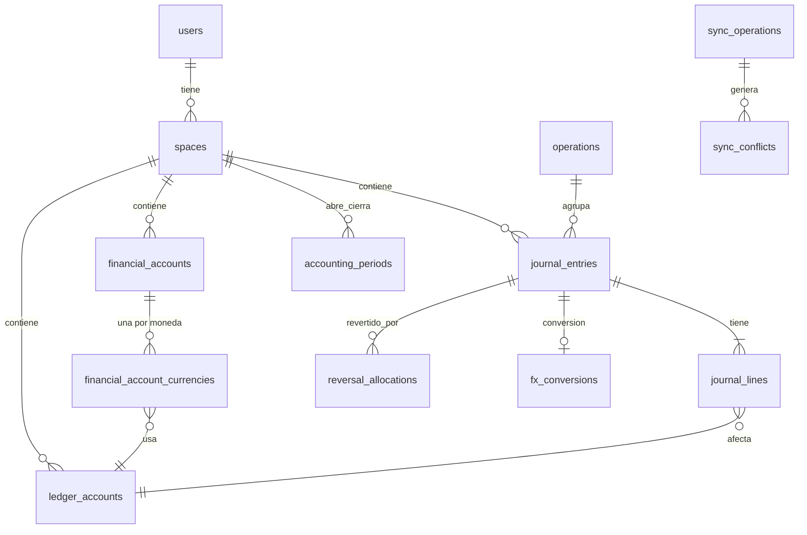

# Modelo de datos (v0.5 — implementado en migraciones)

> Reemplaza al v0.4 anterior, que no estaba en el repositorio y por lo tanto **no se auditó tabla por tabla**. Pendiente.

## Reglas reforzadas en base de datos
- `journal_lines (entry_id, space_id)` → `journal_entries (id, space_id)` y `(ledger_account_id, space_id)` → `ledger_accounts (id, space_id)`: un apunte no puede tocar cuentas de otro espacio.
- CHECK: importes ≥ 0, un solo lado por apunte, importe total > 0.
- Triggers: confirmar exige Debe = Haber, ≥ 2 apuntes, período abierto y número/fecha contable; confirmado es inmutable.
- Vistas reconstruibles: `v_ledger_balances` (saldos) y `v_entry_reversal` (estado derivado de reversión).

## Fechas por asiento
`occurred_at` (cuándo ocurrió) · `recorded_at` (cuándo ingresó) · `confirmed_at` · `accounting_date` (define el período). Si el período está cerrado, se imputa al primer período abierto y se guarda la fecha pedida en `accounting_date_requested`.

## Tablas previstas y no creadas
Obligaciones/recurrencias, préstamos y cronogramas, tarjetas (resúmenes, cuotas), presupuestos, metas y reservas, impuestos, conciliación e importación, adjuntos, backups, notificaciones, perfiles tributarios, índices de inflación. Ver [[05-Roadmap]].
